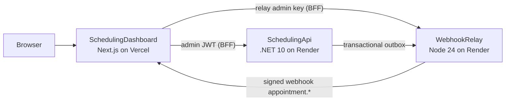
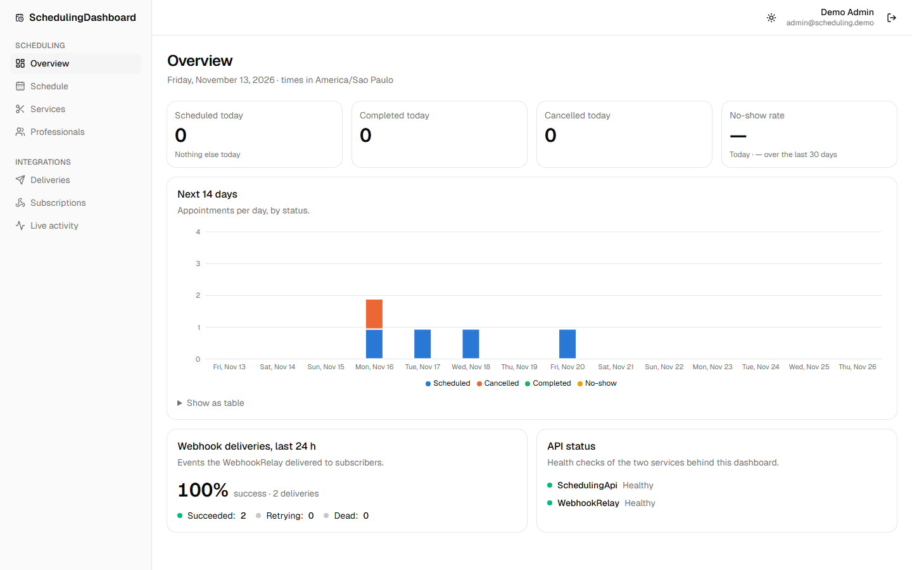
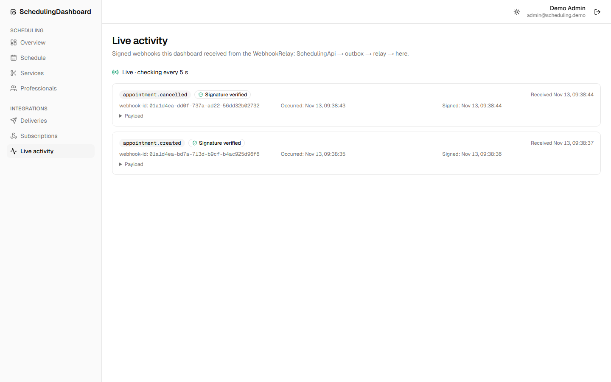

# SchedulingDashboard

[](https://github.com/EduardoCruz78/SchedulingDashboard/actions/workflows/ci.yml)
[](__DEMO_URL__)


[](LICENSE)

Admin dashboard (Next.js, React, TypeScript) for the [SchedulingApi](https://github.com/EduardoCruz78/SchedulingApi):
the day's schedule per professional, services and professionals, KPIs with charts, and the integration side:
deliveries of the [WebhookRelay](https://github.com/EduardoCruz78/WebhookRelay) and a live feed of the signed
webhooks this dashboard receives. It is project 3 of 3 and closes the loop:





## Live demo

**<**DEMO_URL**>**, sign in with the demo admin (the same public credentials as the SchedulingApi demo):
`admin@scheduling.demo` / `Admin123!`. The login page fills them in for you.

Try the whole chain: book an appointment in the [SchedulingApi demo](https://scheduling-api-gf47.onrender.com/scalar)
as `maria@scheduling.demo` / `Customer123!` and watch **Live activity**: the `appointment.created` webhook
arrives signed (and verified) a few seconds later, and **Deliveries** shows it as `succeeded`.

> The APIs run on Render's free plan and sleep after 15 idle minutes; the first request can take about
> 50 seconds. The dashboard warms both up when the login page opens and shows "waking up" (with
> automatic retries) instead of hanging. It runs in **demo mode**: relay subscriptions are read-only, see
> [docs/security.md](docs/security.md#demo-mode-demo_modetrue).

## Technical highlights

- **Backend for frontend.** The browser never sees the API's JWT or the relay's admin key. The JWT is
  kept in an encrypted (JWE), `httpOnly`, `SameSite=Lax` cookie; every read and Server Action re-checks
  the admin session; failed sign-ins are rate-limited per visitor in Postgres, because behind a BFF the
  API sees only the BFF's IPs. → [docs/security.md](docs/security.md)
- **Next.js 16 done the current way.** App Router with Cache Components: every page is a partial
  prerender (static shell + sections streamed in `Suspense`), reads in Server Components, writes in
  Server Actions with `refresh()`, filters and pagination in the URL, nothing from the APIs cached.
  → [ADR 0003](docs/adr/0003-server-components-and-actions.md)
- **Typed clients generated from OpenAPI.** `openapi-typescript` + `openapi-fetch` against versioned
  contracts; CI fails on stale types, and a weekly job compares the contracts with the live APIs.
  Generating them found two real contract bugs, fixed upstream with tests
  ([SchedulingApi#4](https://github.com/EduardoCruz78/SchedulingApi/pull/4),
  [WebhookRelay#1](https://github.com/EduardoCruz78/WebhookRelay/pull/1)).
- **Signed-webhook receiver.** Standard Webhooks verification on the raw body (constant time, 5-minute
  timestamp window, secret rotation), idempotent storage on `webhook-id` (`ON CONFLICT DO NOTHING`), and a
  live feed that polls while the tab is visible. → [ADR 0004](docs/adr/0004-webhook-receiver.md)
- **Errors that make sense.** ProblemDetails (RFC 9457) from both APIs mapped to field errors and
  toasts; a sleeping API becomes "waking up" with auto-retry; a 401 clears the session.
- **Business time zone everywhere**, formatted the same on server and browser (no hydration
  mismatches), DST-safe.
- **Accessible.** Radix-based components, focus management in dialogs, status never by color alone,
  a validated chart palette with a table view, axe checks in light and dark mode.
- **End-to-end tests with the three services built from source** in Docker: a customer books through
  the API, the outbox publishes, the relay signs and delivers, the dashboard verifies and shows it, and
  the admin cancels it from the schedule.



## Running locally

Requirements: Node.js 24 (22.19+ works), Docker.

```bash
npm install
docker compose up -d --wait          # Postgres for the dashboard on port 5435
cp .env.example .env.local           # point it at local or demo APIs
npm run db:migrate
npm run dev                          # http://localhost:3000
```

The whole stack (SchedulingApi + WebhookRelay + dashboard, built from source; the other two
repositories checked out next to this one):

```bash
bash e2e/run.sh
```

| Script                                  | What it does                                                     |
| --------------------------------------- | ---------------------------------------------------------------- |
| `npm run check`                         | lint, formatting, typecheck, tests, build                        |
| `npm test`                              | unit, component and integration tests (integration needs Docker) |
| `npm run api:download` / `api:generate` | refresh the OpenAPI contracts / regenerate the client types      |
| `npm run db:generate` / `db:migrate`    | new Drizzle migration / apply migrations                         |

## Tests

**TEST_TABLE**

## Project structure

```
src/app            routes: login, dashboard pages, API routes (webhook receiver, status, activity)
src/components     shadcn/ui components, shell, forms, chart
src/lib/api        generated contract types, typed clients, ProblemDetails mapping
src/lib/auth       session (JWE cookie), guard, sign-in, login throttle
src/lib/data       data access layer (every call checks the admin session)
src/lib/db         Drizzle schema (received webhooks, login attempts)
src/lib/webhooks   Standard Webhooks receiver
openapi/           versioned API contracts
e2e/               Docker Compose with the three projects + Playwright tests
docs/              architecture, security, ADRs
```

More: [docs/architecture.md](docs/architecture.md) and the [ADRs](docs/adr).

## Roadmap

- Customer names on the schedule (needs an admin lookup endpoint in the SchedulingApi).
- Push instead of polling for the live feed (SSE on a long-lived server or a managed realtime service).
- Creating relay subscriptions from the dashboard outside demo mode (the secret shown once).

<details>
<summary>🇧🇷 Em português</summary>

**SchedulingDashboard** é o painel administrativo (Next.js, React, TypeScript) da
[SchedulingApi](https://github.com/EduardoCruz78/SchedulingApi): agenda do dia por profissional, cadastro de
serviços e profissionais (expediente e folgas), indicadores com gráfico e a parte de integrações, com as
entregas do [WebhookRelay](https://github.com/EduardoCruz78/WebhookRelay) e um feed ao vivo dos webhooks
assinados que o próprio painel recebe. É o projeto 3 de 3 do portfólio e fecha o ciclo: um agendamento
feito na API vira evento no outbox, o relay assina e entrega, e o painel verifica e mostra.

Destaques: padrão BFF (o navegador nunca vê o JWT nem a chave admin; sessão em cookie `httpOnly`
criptografado), Next.js 16 com Server Components, Server Actions e streaming, clientes tipados gerados do
OpenAPI (que encontraram dois bugs reais de contrato nos projetos 1 e 2, corrigidos por PR com teste),
receptor de webhooks com verificação Standard Webhooks e deduplicação, modo demo seguro, acessibilidade
checada com axe e testes de ponta a ponta subindo os três projetos a partir do código.

Demo: <**DEMO_URL**> (admin `admin@scheduling.demo` / `Admin123!`). As APIs dormem no plano gratuito do
Render; o primeiro acesso pode levar cerca de 50 segundos.

</details>

## License

[MIT](LICENSE)
