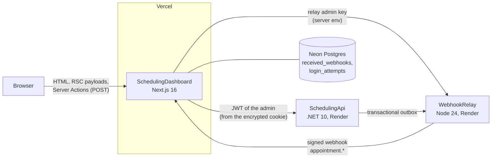

# Architecture

SchedulingDashboard is the admin front end of a three-project portfolio. It never lets the browser talk
to the APIs: it is a **backend for frontend (BFF)** that holds the credentials, decides what an admin may
do and renders the result.



## Request flow

| Kind       | Where it runs                                    | What it does                                                                 |
| ---------- | ------------------------------------------------ | ---------------------------------------------------------------------------- |
| Page read  | Server Component inside `<Suspense>`             | `requireAdmin()` → typed client → API → HTML streamed into the static shell  |
| Write      | Server Action                                    | re-checks the session → API → `refresh()` → toast message                    |
| Live feed  | Client Component                                 | polls `GET /api/activity` every 5 s while the tab is visible                 |
| Webhook    | Route Handler `POST /api/webhooks/webhook-relay` | verifies the signature on the raw body → `INSERT ... ON CONFLICT DO NOTHING` |
| Cold start | `GET /api/status`                                | pings both `/health` with a 55 s timeout; the login page calls it on load    |

## Rendering model (Next.js 16, Cache Components)

- Every page is a **partial prerender**: the layout, navigation, headings and skeletons are built at
  build time; each data section streams in its own `<Suspense>` at request time.
- **Nothing from the APIs is cached** (`use cache` is never used for admin data). After a write the
  action calls `refresh()`, which re-renders the current route with fresh data.
- Reads that fail because of the API return a value (`load()`), rendered as "waking up, retrying" or
  as the API's message; only bugs reach the `catchError` boundaries. In production Next.js hides the
  message of errors thrown while rendering, so a boundary alone could not tell a cold start from a bug.

## Modules

```
src/
  app/                     routes: (auth)/login, (dashboard)/*, api/*, auth/signout
  components/              ui/ (shadcn, generated), shell/, form/, charts/, shared pieces
  lib/
    api/                   generated contract types, typed clients, ProblemDetails -> ApiError, health
    auth/                  session (JWE cookie), guard, sign-in, login throttle, safe redirects
    data/                  data access layer: every read/write checks the admin session first
    db/                    Drizzle schema and client (server-only)
    validation/            Zod schemas mirroring the API's rules
    webhooks/              the Standard Webhooks receiver
    time.ts, schedule.ts, overview.ts, demo.ts   pure logic, unit-tested
  proxy.ts                 optimistic route guard (cookie present?)
  instrumentation.ts       validates the environment when the server boots
```

`server-only` marks every module that touches secrets, cookies or the database; importing one from a
Client Component fails the build.

## Data

The dashboard's own database is small and only stores what the APIs cannot:

| Table               | Why                                                                                                             |
| ------------------- | --------------------------------------------------------------------------------------------------------------- |
| `received_webhooks` | the live feed; `webhook_id` (Standard Webhooks `webhook-id`) is the primary key, so redeliveries are idempotent |
| `login_attempts`    | failed sign-ins per visitor (HMAC of the IP) for the BFF's own rate limit                                       |

Migrations live in `drizzle/` and run with `npm run db:migrate`: in the Vercel production build, in
the e2e compose as a one-off container, and locally by hand. CI fails when the schema changes without a
migration, and when the generated API types do not match the versioned contracts in `openapi/`.

## Tests

| Layer       | Tool                          | Examples                                                                                                                                                                |
| ----------- | ----------------------------- | ----------------------------------------------------------------------------------------------------------------------------------------------------------------------- |
| Unit        | Vitest                        | time zone and DST, ProblemDetails mapping, session sealing, timeline layout, demo rules, validation                                                                     |
| Component   | Testing Library (jsdom)       | cancel dialog focus and errors, service form field errors, deliveries table paging, feed polling                                                                        |
| Integration | Vitest + MSW + Testcontainers | Server Actions against a fake API (401, 409, 422, timeout), sign-in throttle and webhook receiver on real Postgres                                                      |
| End to end  | Playwright + axe-core         | the three projects built from source in Docker: login, create a service, booking → signed webhook → live feed, cancel from the schedule, accessibility (light and dark) |
